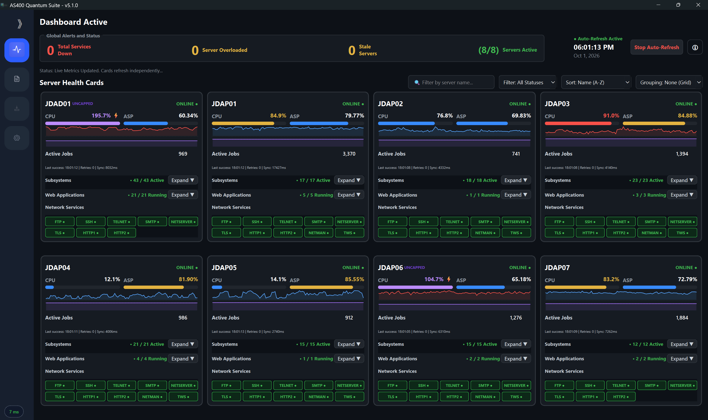
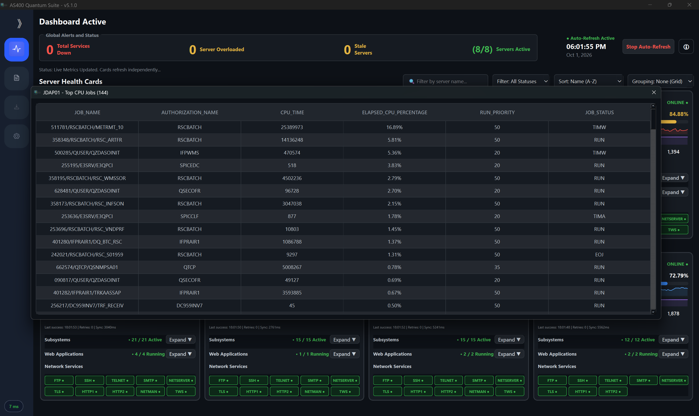
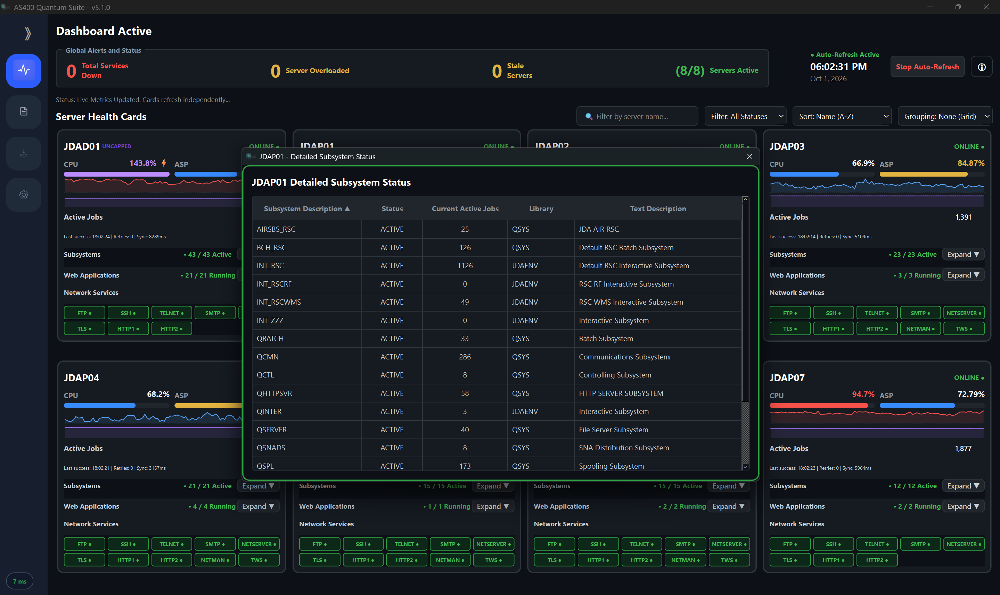
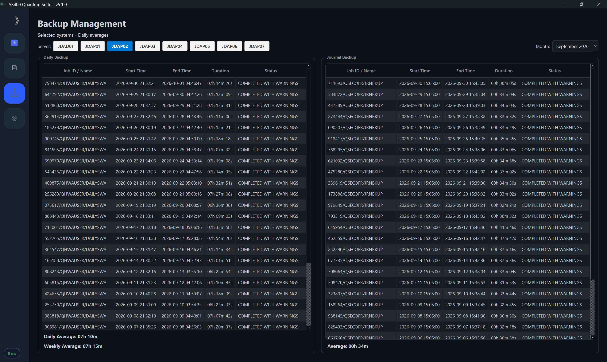
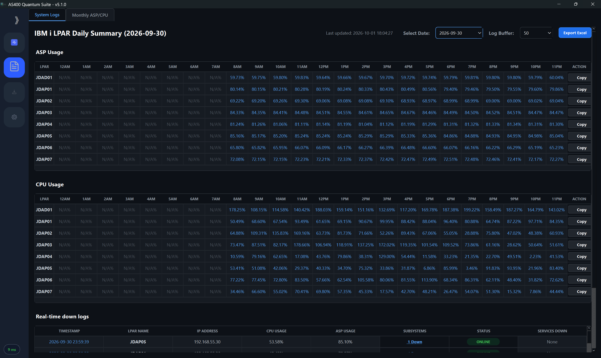
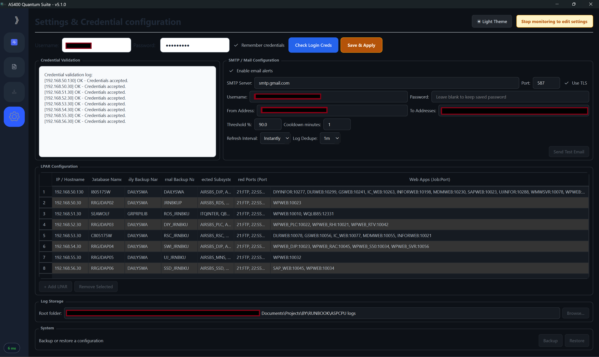

# AS400 Quantum Suite

**AS400 Quantum Suite 5.6.0** is a Windows desktop monitoring and operations dashboard for IBM i (AS/400) environments. It connects to configured IBM i systems through DB2/ODBC and presents live LPAR status, capacity metrics, service checks, backup history, and monthly reports in a PyQt6 application.

## Features

- **Live Monitor:** Per-server status cards for CPU, ASP, active jobs, subsystem health, web applications, and configured network services. Monitoring runs in background workers with per-server refresh and connection status.
- **ASP alerts:** The configured ASP threshold is the critical level. A warning is raised 2% below it by default; warnings are silent and highlighted orange, while critical alerts are highlighted red and sound. SMTP notifications include the server name, IP, current ASP usage, and configured critical threshold.
- **Server status alerts:** Server-down email notifications are delayed by three seconds and suppressed if the VPN disconnects or the server recovers during that delay.
- **Logs & Analytics:** Browse persisted monitoring history and monthly CPU/ASP trends. Log history is refreshed when this page is visible, avoiding background OneDrive log-folder scans on the dashboard. Export monthly reports to Excel and generate a report for the previous month.
- **Backup Management:** Review daily, weekly, monthly, and journal backup history in two panels by server and month, including duration, start/end times, and daily, weekly, and monthly averages.
- **Settings & Credentials:** Configure IBM i connections, expected subsystems and ports, email/SMTP alerts, refresh preferences, and the logs folder. Validate credentials, send a test email, and back up or restore application settings.
- **Startup checks:** Check the configured expiration date and compare the installed version with the published minimum supported version.

## Screenshots













## Requirements

- Windows 10 or later
- Python 3.10 or later for running from source
- IBM i Access ODBC driver (or compatible DB2 ODBC driver)
- Network access and valid credentials for the monitored IBM i systems
- SMTP server details if email alerts are required
- A writable local, network, OneDrive, or SharePoint folder for monitoring logs

Python dependencies are listed in `requirements.txt`. Password storage uses the operating system keyring when available; an SMTP password can also be supplied using `SMTP_PASSWORD` or `APP_SMTP_PASSWORD`.

## Run From Source

Install dependencies from the repository root:

```powershell
python -m pip install -r requirements.txt
```

Install and configure the IBM i ODBC driver, then start the application:

```powershell
python src/main.py
```

Use **Settings & Credentials** to configure server hosts/databases, credentials, expected subsystems and ports, email settings, and the log storage folder. Start monitoring from **Live Monitor** after validating the required credentials and network access.

## Tutorial: Using The Application

### 1. Prepare the workstation

Before opening the dashboard, make sure the workstation can reach the IBM i systems and has the IBM i Access ODBC driver installed. Connect to the required VPN first; the credential check expects the workstation's IPv4 address to start with `10.212`. Email alerts also require access to the configured SMTP server.

Start the application using the source or installer instructions above. On startup, the app checks its build expiration and checks the published minimum version in the background. The main window can open while the version check runs.

### 2. Configure IBM i systems

1. Open **Settings & Credentials** and select **LPAR Configuration**.
2. Use **+ Add LPAR** to add a row for each system. Enter its IP address or host name and database name. Fill in the backup job names if you want backup history, and set expected subsystems, monitored ports (`Port:Name`), and web apps (`Job:Port`) as needed.
3. Select **Storage & System** and choose the log storage root. This should be a writable folder accessible to the operator account; a shared OneDrive or SharePoint folder can be used.
4. Click **Save Changes** to apply the LPAR and storage configuration before validating credentials.
5. Select **Credentials**, enter the IBM i username and password, and click **Check Login Creds**. The app checks the configured systems and reports which connections passed. Monitoring is enabled only when credentials have been validated and at least one LPAR is configured. Use **Remember credentials** only if you want the app to remember the username and save the IBM i password in the operating system keyring when available.

For email notifications, open **SMTP Config**, enable email alerts, enter the SMTP server, port, sender and recipient addresses, and credentials, then click **Save Changes** and **Send Test Email**. Configure the ASP threshold and cooldown there. The threshold is the critical point; the warning level is normally two percentage points below it. Warning alerts are shown in orange and are silent; critical alerts are shown in red and sound. Email delivery also depends on the SMTP server accepting the configured account and recipients.

### 3. Start live monitoring

1. Open **Live Monitor** and click **Start Auto-Refresh**.
2. The app checks network availability, then queries configured IBM i systems independently in background workers. The dashboard cards show each system's connection state, CPU and ASP usage, active jobs, subsystem health, and configured service or web-app checks.
3. Keep the dashboard open to watch refresh status and alerts. Use the card details to inspect a system. To pause monitoring and unlock settings for editing, click **Stop Auto-Refresh**.

If a system cannot be reached, check the VPN and host/database configuration, confirm the IBM i ODBC driver is installed, and verify that the credentials check succeeds. System events and connection errors are available in **Settings & Credentials** under **System Logs**.

### 4. Understand logs and reports

Monitoring results are written to daily JSON history files under the selected log root, organized by year and month. The app writes local history before attempting Excel export, so missing or unavailable workbooks do not remove the saved JSON history. Logs & Analytics reads this persisted history; open it to view **System Logs**, or select **Monthly ASP/CPU** to review monthly CPU and ASP trends.

To update the shared hourly workbooks, place `BY - ASP YYYY.xlsx` and `BY - CPU YYYY.xlsx` in the matching `YYYY` folder under the selected log root. Each workbook needs a worksheet matching the IBM i host name and date/hour cells in its template. After every configured server has supplied a reading for that hour, the app writes the batch and saves each workbook. A missing workbook, sheet, or matching cell—or a workbook open in Excel—is reported in System Logs; JSON history remains available.

In **Monthly ASP/CPU**, choose a month and click **Export to Excel** to save a report as an Excel workbook or CSV. The report is calculated from saved local history. **Generate Previous Month** is available when generating the prior month is appropriate.

### 5. Review backup history

After credential validation, open **Backup Management** and choose a configured server and month. The page fetches backup information from IBM i and presents daily/weekly, monthly, and journal backup panels, with run times, durations, status, and averages where available. Backup history is queried from the systems; it is separate from the locally persisted CPU/ASP monitoring history.

### 6. Know what is saved

- Application configuration is stored in the current user's application data directory. Passwords are stored in the operating system keyring when available; SMTP settings can also be supplied through environment variables.
- JSON monitoring history is stored in the configured log root, with a local application logs-folder fallback if the preferred location is unavailable.
- Settings can be backed up or restored from **Storage & System**. Treat a settings backup as sensitive: it may contain credentials.
- The app removes older daily monitoring logs under its 30-day retention policy. Keep any archives or settings backups in an access-controlled location.

## Configuration And Data

- Application settings are stored in the current user's application data directory under `AS400 Quantum Suite`.
- The log root is configurable in the application. Put the shared `BY - ASP YYYY.xlsx` and `BY - CPU YYYY.xlsx` workbooks in its `YYYY` folder, with a worksheet for each IBM i host name. After all configured servers report for an hour, monitoring batches their readings into the matching worksheet and date/hour cell, then saves each workbook once. Successful workbook updates and failures are reported in System Logs.
- Daily JSON monitoring history remains in a separate `YYYY\Month Year` folder and is used by Logs & Analytics and monthly reports. JSON records are saved locally before Excel export, so a missing, unavailable, or mismatched workbook does not discard local history. If the preferred archive location is unavailable, JSON log writes can fall back to the application's local logs folder.
- Cleanup retains the current and previous calendar months for reporting; older canonical daily logs are subject to the 30-day retention policy.
- Keep settings backups and log archives in locations accessible to the operator account. Do not include credentials or private logs in public source-control commits.

## Build And Installer

The repository includes a PyInstaller spec and an Inno Setup script. On Windows, install the dependencies, then build the application bundle:

```powershell
pyinstaller AS400QuantumSuite.spec
```

The installer script `setup.iss` packages the generated `dist\AS400QuantumSuite` folder. Compile it with Inno Setup after the PyInstaller build.

## Tests

Run the pytest suite from the repository root:

```powershell
python -m pytest -q
```

Tests cover alert escalation and messaging, monitoring/log behavior, settings persistence, reporting, and dashboard interactions.

## Project Layout

```text
AS400QuantumSuite.spec   PyInstaller application bundle
setup.iss                Windows installer definition
version.json             Published version metadata
src/main.py              Application startup
src/config.py            Application metadata and paths
src/worker.py            IBM i queries, monitoring, alerts, and log workers
src/ui/                  Dashboard, logs, reports, backup, and settings UI
src/dialogs.py           Dialogs and configuration screens
src/version_worker.py    Remote version check
Image & Sound/           App icons and alert sounds
tests/                   Pytest regression tests
```

## Version Information

The application version is **5.6.0**. Startup checks enforce the configured build expiration and compare the installed version with the published minimum version. Published version metadata is checked using the URL configured in `src/config.py`.

---

<<<<<<< HEAD
[📖 Read the User Guide](./USER_GUIDE.md)
=======
[📖 Read the User Guide](./USER_GUIDE)
>>>>>>> dc5c63e (Changes on UI, Addtional monitoring tracker -Monthlu backup, Excel update ASP/CPU)
